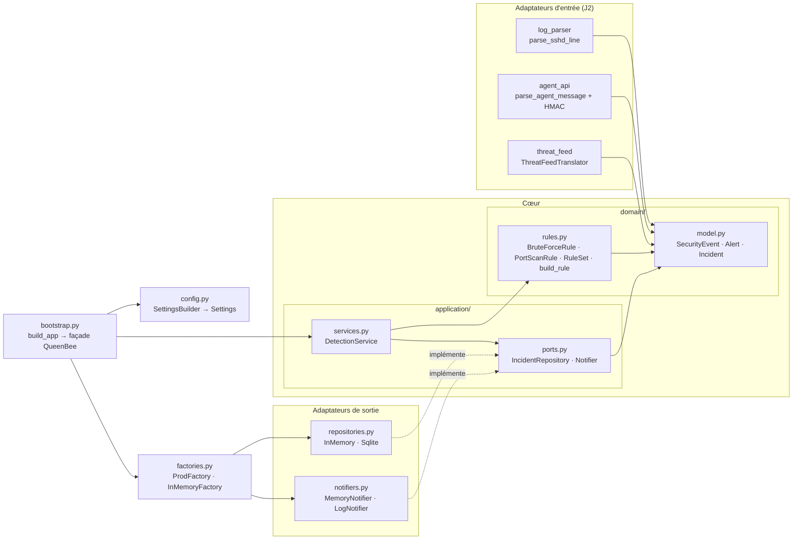
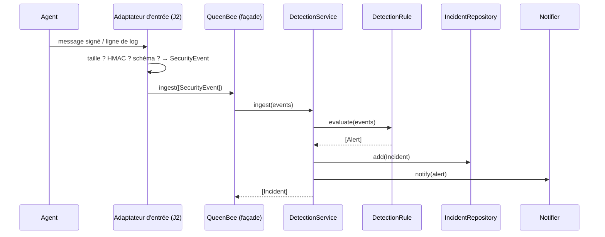

# Architecture hexagonale de Queen Bee

- **État** : fin du J1 (étiquette `j1-rendu`), à compléter au J2
- **Voir aussi** : `docs/threat_model.md` (menaces et exigences), `docs/refactoring_legacy.md` (d'où vient le code),
  `docs/adr/0001-architecture-hexagonale.md` (la décision, rédigée au J2)

## 1. L'idée en une phrase

Le **cœur** (domaine et cas d'usage) ne connaît rien de la technique : il exprime ses besoins par des **ports**
(contrats `typing.Protocol`), et des **adaptateurs** interchangeables branchent le monde extérieur sur ces ports
(base SQLite ou mémoire, journal ou mémoire, API d'agents, parseur de logs…). Toutes les dépendances
pointent **vers le centre**.

## 2. Vue d'ensemble



Flèche pleine : « importe ». Flèche pointillée : « respecte le contrat de » (typage structurel, sans héritage).

## 3. Les couches et leurs règles

| Couche | Dossier | Contient | A le droit d'importer | Interdit |
|---|---|---|---|---|
| **Domaine** | `src/queenbee/domain/` | entités, objets-valeurs, règles métier, `DomainError` | la bibliothèque standard uniquement | toute I/O : `sqlite3`, `smtplib`, réseau, fichiers |
| **Application** | `src/queenbee/application/` | cas d'usage, ports (`Protocol`), contrôle d'accès (J2) | `domain` | les adaptateurs concrets |
| **Adaptateurs** | `src/queenbee/adapters/inbound`, `outbound` | traduction monde extérieur ↔ ports | `application`, `domain` | `bootstrap` |
| **Démarrage** | `src/queenbee/bootstrap.py` | composition root et façade | tout | — |
| Hors couches | `config.py`, `factories.py` | configuration validée, familles de composants | ce dont ils ont besoin | état global |

**Vérification automatique** : `import-linter` (contrat `layers` dans `pyproject.toml`) fait échouer la chaîne
si une couche basse importe une couche haute.

```bash
PYTHONPATH=src lint-imports          # Windows : $env:PYTHONPATH="src"; lint-imports
# Contracts: 1 kept, 0 broken.
```

## 4. Le domaine (`domain/`)

| Élément | Rôle | Garanties |
|---|---|---|
| `SecurityEvent` | un événement remonté par un agent | figé (`frozen`, `slots`) ; IP valide (`ipaddress`) ; nom ≤ 64 caractères et sur liste blanche (`fullmatch`) ; action dans `ALLOWED_ACTIONS` ; horodatage avec fuseau |
| `Alert` | résultat d'une règle | figé ; règle non vide, IP valide, gravité connue |
| `Severity` | `LOW` < `MEDIUM` < `HIGH` < `CRITICAL` | `IntEnum` ordonné |
| `Incident` | seule entité mutable | identifiant `UUID` ; statut modifié uniquement par `transition_to` |
| `IncidentStatus` + `_TRANSITIONS` | pattern **State** | `OPEN → TRIAGED → (CONTAINED →) CLOSED` ; tout le reste lève `DomainError` |
| `DetectionRule` | pattern **Strategy** (`Protocol`) | `evaluate(events) -> list[Alert]` |
| `BruteForceRule`, `PortScanRule` | règles concrètes | seuil entier ≥ 1, `True` refusé ; copie par `dataclasses.replace` revalidée (**Prototype**) |
| `RuleSet` | pattern **Composite** | N règles se comportent comme une ; aucune n'est sautée |
| `build_rule` + `_REGISTRY` | pattern **Factory** | seuls les noms enregistrés ; aucun `getattr` ni `importlib` sur une chaîne reçue |

Principe : **un objet invalide ne peut pas exister**. La validation a lieu dans `__post_init__` ; tout refus
lève `DomainError`, jamais corrigé en silence.

## 5. L'application (`application/`)

### Ports (`ports.py`)

| Port | Méthodes | Adaptateurs actuels |
|---|---|---|
| `IncidentRepository` | `add`, `get`, `save`, `list_open` | `InMemoryIncidentRepository`, `SqliteIncidentRepository` |
| `Notifier` | `notify(alert)` | `MemoryNotifier`, `LogNotifier` |
| `Firewall` (J2) | `block`, `unblock` | `InMemoryFirewall` (J2) |

### Cas d'usage (`services.py`)

`DetectionService(rule, incidents, notifiers).ingest(events)` : évalue la règle, ouvre un `Incident` par alerte,
l'enregistre par le port `IncidentRepository` et prévient chaque `Notifier` (**Observer** : ajouter un abonné ne
modifie pas le service).

Au J2, `IncidentService.move(who, incident_id, to)` suivra toujours le même ordre :
**autoriser → vérifier → règle métier → persister**.

## 6. Les adaptateurs (`adapters/`)

| Sens | Module | Rôle | Sécurité à la frontière |
|---|---|---|---|
| sortie | `outbound/repositories.py` | stockage des incidents | SQL **toujours paramétré**, aucune f-string ; relecture reconstruite par les constructeurs du domaine (une ligne altérée en base est refusée) |
| sortie | `outbound/notifiers.py` | diffusion des alertes | `LogNotifier` journalise vers `queenbee.alerts` (relayé au SIEM) sans contenu brut issu des logs |
| entrée (J2) | `inbound/log_parser.py` | ligne sshd → `SecurityEvent` | taille bornée avant la regex, `fullmatch`, le domaine revalide |
| entrée (J2) | `inbound/agent_api.py` | message JSON d'agent → `SecurityEvent` | HMAC-SHA256 comparé à temps constant, schéma strict, taille bornée |
| entrée (J2) | `inbound/threat_feed.py` | couche anti-corruption du flux de menaces | indicateur traduit et validé, sinon `DomainError` |

## 7. Démarrage, configuration et familles

- **`config.py`** — pattern **Builder** : `SettingsBuilder().hmac_key(...).db_path(...).bf_threshold(...).build()`
  valide l'ensemble et rend des `Settings` figés. `settings_from_env(os.environ)` lit `QUEENBEE_AGENT_KEY`
  (hexadécimal, ≥ 32 octets, **aucune valeur par défaut**), `QUEENBEE_DB`, `QUEENBEE_BF_THRESHOLD`.
  La clé est en `repr=False` : absente de `print()` et des journaux. Toute erreur lève `ConfigError` :
  l'application refuse de démarrer.
- **`factories.py`** — pattern **Abstract Factory** : `ProdFactory(db_path)` (SQLite + journal) ou
  `InMemoryFactory()` (mémoire). Un service reçoit une seule famille, donc ne mélange jamais une vraie base et une
  fausse notification.
- **`bootstrap.py`** — **composition root** : `build_app(settings, factory=None)` crée chaque objet une fois et
  le passe explicitement ; c'est le seul endroit qui connaît les classes concrètes. Il remplace le Singleton et les
  variables globales du script hérité. Il renvoie la façade `QueenBee` (pattern **Facade**), seule porte d'entrée.

```python
from queenbee.bootstrap import build_app
from queenbee.config import settings_from_env
import os

app = build_app(settings_from_env(os.environ))   # famille prod par défaut
incidents = app.ingest(events)                   # events : list[SecurityEvent] déjà validés
```

## 8. Parcours d'un événement



## 9. Pourquoi cette architecture sert la sécurité

| Bénéfice | Lien avec le modèle de menaces |
|---|---|
| Toute donnée externe devient un objet du domaine **à la frontière** ; après, plus aucune chaîne brute ne circule | T et D sur TB1 (EX-02, EX-03, EX-12) |
| Le SQL n'existe que dans un adaptateur, toujours paramétré | T et I sur TB2 (EX-04) |
| Les secrets ne vivent que dans `Settings`, injectés au démarrage, masqués | I au démarrage (EX-07) |
| L'autorisation sera dans le cas d'usage : aucune porte d'entrée ne peut la contourner (J2) | E sur TB4 (EX-05) |
| Le cœur se teste sans base ni réseau, avec des doublures en mémoire | suite rapide, tests d'abus faciles à écrire |
| La règle de dépendance est vérifiée par une machine (`lint-imports`) | l'architecture ne se dégrade pas en silence |

**Coûts assumés** : plus de fichiers et d'indirections qu'un script ; discipline d'équipe nécessaire pour garder
le domaine pur ; un contrat `Protocol` doit être tenu à jour quand un port évolue.

## 10. Étendre sans casser (ouvert-fermé)

| Besoin | Ce qu'on fait | Ce qu'on ne touche pas |
|---|---|---|
| Nouvelle règle de détection | une classe avec `evaluate`, enregistrée dans `_REGISTRY` | `DetectionService`, les autres règles |
| Nouvelle base de données | un adaptateur qui respecte `IncidentRepository`, branché dans une fabrique | domaine, cas d'usage |
| Nouveau canal d'alerte | un adaptateur `Notifier` ajouté à la liste des abonnés | `DetectionService` |
| Nouvelle source d'événements | un adaptateur d'entrée qui produit des `SecurityEvent` | tout le cœur |

## 11. État d'avancement

| Élément | État |
|---|---|
| `domain/` (model, rules) | fait (J1) |
| `application/ports.py`, `services.py` (`DetectionService`) | fait (J1) |
| `adapters/outbound` (dépôts, notificateurs mémoire et journal) | fait (J1) |
| `config.py`, `factories.py`, `bootstrap.py` | fait (J1) |
| `Principal`, `IncidentService`, `IncidentReadProxy` (Proxy), `AccessDeniedError` | J2 |
| `AuditedNotifier`, `RateLimitedNotifier` (Decorator) | J2 |
| `adapters/inbound` (log_parser, agent_api, threat_feed) ; `ingest_lines` sur la façade | J2 |
| `Firewall`, `BlockIpCommand`, `CommandHistory` (Command) | J2 |
| Compte base sans droits DDL, zones réseau, matrice des flux | J3 |
