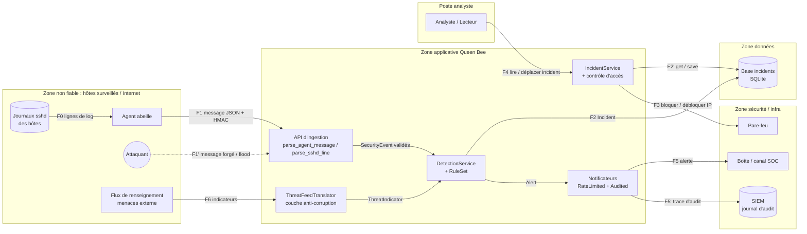

# Modèle de menaces — Queen Bee

- **Statut** : brouillon J1-A1 — 14/10/2026
- **Auteur** : Andy
- **Méthode** : actifs → acteurs → DFD et frontières de confiance → STRIDE par flux → exigences EX-nn testables
- **Périmètre** : la plateforme Queen Bee (ingestion des événements d'agents, détection, gestion des incidents,
  notification du SOC, blocage d'IP). Hors périmètre : la sécurité des hôtes surveillés eux-mêmes,
  l'infrastructure réseau sous-jacente (traitée au J3-A2).

---

## 1. Actifs

DICP : **D**isponibilité · **I**ntégrité · **C**onfidentialité · **P**reuve.

| # | Actif | Pourquoi il compte | D | I | C | P |
|---|---|---|:-:|:-:|:-:|:-:|
| A1 | **Événements de sécurité** (`SecurityEvent`) remontés par les agents | matière première de la détection : un faux événement crée un faux incident, un événement supprimé masque une attaque | ✔ | ✔ | | ✔ |
| A2 | **Incidents** et leur cycle de vie (`OPEN → TRIAGED → CONTAINED → CLOSED`) | pilotent la réponse du SOC ; servent de preuve en cas d'enquête ou de plainte | ✔ | ✔ | ✔ | ✔ |
| A3 | **Clé HMAC des agents** (`QUEENBEE_AGENT_KEY`) | quiconque la possède peut se faire passer pour n'importe quel agent et injecter de faux événements | | ✔ | ✔ | |
| A4 | **Règles de détection et seuils** (`BruteForceRule`, `PortScanRule`, `threshold`) | un attaquant qui relève un seuil ou désactive une règle devient invisible | ✔ | ✔ | | |
| A5 | **Journal d'audit** (logger `queenbee.audit`, envoyé au SIEM) | seule preuve de « qui a fait quoi, quand » ; doit être non effaçable par l'application | | ✔ | | ✔ |
| A6 | **Liste de blocage du pare-feu** | une IP légitime bloquée = déni de service auto-infligé ; une IP malveillante débloquée = intrusion | ✔ | ✔ | | ✔ |
| A7 | **Identités et rôles** des utilisateurs (`Principal`, rôles `analyst` / `viewer`) | un rôle usurpé ou élevé permet de clore un incident en cours ou de lire des données sensibles | | ✔ | ✔ | ✔ |
| A8 | **Canal d'alerte vers le SOC** (notificateurs) | si le SOC est inondé ou aveuglé, les vraies alertes passent inaperçues | ✔ | ✔ | | |

---

## 2. Acteurs

| Acteur | Légitime ? | Ce qu'il peut faire / ce qu'il veut |
|---|---|---|
| **Agent (« abeille »)** | oui | envoie des événements signés depuis un hôte surveillé |
| **Analyste SOC** (`analyst`) | oui | lit, trie, confine et clôt les incidents ; déclenche un blocage d'IP |
| **Lecteur** (`viewer`) | oui | lit les incidents, ne doit rien modifier |
| **Administrateur** | oui | déploie, configure les règles et les secrets |
| **Fournisseur de flux de menaces** (`ThreatFeedTranslator`) | oui, mais externe | fournit des indicateurs (IP + niveau de risque) au format qu'il choisit |
| **Attaquant externe** | non | atteint l'API d'ingestion depuis le réseau ; veut injecter, saturer ou se cacher |
| **Attaquant « dans les journaux »** | non | contrôle une partie du contenu loggé (ex. le nom d'utilisateur tapé dans `ssh`) sans jamais toucher Queen Bee directement : injection de second ordre |
| **Agent compromis** | **a l'air légitime, ne l'est plus** | possède une vraie clé HMAC : ses messages sont correctement signés mais leur contenu est hostile (faux événements, flood, champs en trop) |
| **Initié malveillant** (lecteur ou analyste) | a l'air légitime | tente de dépasser son rôle ou d'effacer ses traces |

---

## 3. Diagramme de flux de données (DFD) et frontières de confiance

### Frontières de confiance

| Frontière | Entre… | Pourquoi c'est une frontière |
|---|---|---|
| **TB1** | Agents (et tout le réseau) → API d'ingestion | les données viennent de machines qu'on ne contrôle pas entièrement ; le contenu des logs est en partie écrit par l'attaquant ; un agent peut être compromis. **Toute donnée y est non fiable.** |
| **TB2** | Application → base des incidents | passage du code au stockage : une donnée mal séparée du code SQL devient une commande ; la base survit à l'application et sert de preuve |
| **TB3** | Application → pare-feu | Queen Bee agit sur l'infrastructure : une IP piégée transmise à une commande système peut modifier tout le filtrage |
| **TB4** | Analyste / lecteur → service des incidents | changement de niveau de privilège : l'utilisateur authentifié n'a pas forcément le droit de faire ce qu'il demande |
| **TB5** | Application → SOC et SIEM | sortie de données sensibles vers des systèmes tiers ; risque de fuite et d'inondation |
| **TB6** | Fournisseur de flux de menaces → application | modèle de données externe, imposé par un tiers, qui ne doit pas contaminer le domaine |

---

## 4. STRIDE par flux traversant une frontière

Seules les menaces jugées **crédibles** sont gardées. Case vide = menace jugée non pertinente sur ce flux.

| Flux | S · usurpation | T · altération | R · répudiation | I · fuite | D · déni de service | E · élévation | Exigences |
|---|---|---|---|---|---|---|---|
| **F1** Agent → API (TB1) | faux agent sans clé ; agent compromis qui se fait passer pour un autre | message modifié en transit ; champ ajouté (`is_admin`) ; IP ou nom piégé | un agent nie avoir envoyé un message | | message géant, regex à retour arrière, flood de messages | champ en trop interprété comme un privilège | EX-01, EX-02, EX-03 |
| **F0** Journaux → parseur (TB1) | nom d'utilisateur forgé dans `ssh` | `<script>`, `OR 1=1`, octets nuls dans la ligne | | | ligne de 10 000 caractères, entrée adverse pour la regex | | EX-03 |
| **F2** Application → base (TB2) | | injection SQL via l'IP ou le nom ; incident modifié hors cycle de vie | modification d'incident sans trace | lecture de toute la table par injection | | requête qui sort de son périmètre (DDL) | EX-04 |
| **F3** Application → pare-feu (TB3) | | IP piégée `10.0.0.1; iptables -F` qui vide les règles | blocage non tracé, impossible à justifier | | blocage massif d'IP légitimes | commande système exécutée avec les droits du service | (EX-09) |
| **F4** Analyste → incidents (TB4) | usurpation d'un analyste | incident clos sans passer par le triage | « ce n'est pas moi qui ai clos l'incident » | un lecteur sans rôle lit les incidents | | **un lecteur clôt ou déplace un incident** | EX-05, EX-06 |
| **F5** Application → SOC / SIEM (TB5) | | | alerte émise sans trace d'audit | clé ou secret affiché dans un log, un `print` ou une trace d'erreur | **1 000 alertes en rafale aveuglent le SOC** | | EX-06, EX-07, EX-08 |
| **F6** Flux de menaces → ACL (TB6) | fournisseur usurpé | indicateur invalide (`evil.com` au lieu d'une IP), champ manquant | | | | | (EX-10) |
| **Démarrage** Environnement → configuration | | | | secret par défaut, secret versionné, clé trop courte | | | EX-07 |

Les 6 lettres STRIDE sont couvertes au moins une fois ; chaque frontière porte au moins une menace.

---

## 5. Exigences de sécurité (EX-nn, testables)

Format : `EX-nn <Quoi> DOIT <critère mesurable>.` · Menace · Propriété DICP · Preuve (test qui échoue si l'exigence est violée).

**EX-01** — Tout message d'agent DOIT porter une signature HMAC-SHA256 valide, vérifiée par comparaison à temps constant ;
un message signé avec une autre clé DOIT être rejeté par `UnauthenticatedError` avant toute analyse du contenu.
- Menace : **S** sur TB1 (faux agent) · Propriété : **Intégrité**
- Preuve : `tests/test_adapters.py::test_abuse_forged_signature_rejected` (+ cas nominal `test_agent_message_authenticated`)

**EX-02** — Le schéma d'un message d'agent DOIT être strict : exactement les champs `source_ip`, `username`, `action`,
`timestamp` ; tout champ inconnu DOIT entraîner un rejet `DomainError`.
- Menace : **T** et **E** sur TB1 (agent compromis qui ajoute `is_admin`) · Propriété : **Intégrité**
- Preuve : `tests/test_adapters.py::test_abuse_extra_field_rejected`

**EX-03** — Toute ligne de journal piégée (injection, balise HTML, octets nuls, plus de 512 caractères) DOIT être rejetée
par `DomainError`, et 1 000 lignes adverses DOIVENT être traitées en moins de 1 s.
- Menace : **D** et **T** sur TB1 (ReDoS, injection de second ordre) · Propriété : **Disponibilité**, **Intégrité**
- Preuve : `tests/test_adapters.py::test_parser_is_fast_on_adversarial_input`, `tests/test_adapters.py::test_malicious_lines_rejected`,
  `tests/test_adapters.py::test_parser_never_crashes_unexpectedly` (Hypothesis)

**EX-04** — Toute requête vers la base des incidents DOIT être paramétrée (aucune donnée concaténée dans le SQL) ;
un incident stocké puis relu DOIT être identique à l'original.
- Menace : **T** et **I** sur TB2 (injection SQL) · Propriété : **Intégrité**, **Confidentialité**
- Preuve : `tests/test_services.py::test_sqlite_repo_resists_injection` + règle `ruff S608` bloquante dans `make check`

**EX-05** — Un utilisateur sans le rôle `analyst` NE DOIT PAS pouvoir changer le statut d'un incident :
la demande DOIT lever `AccessDeniedError` et l'incident DOIT rester dans son statut d'origine.
- Menace : **E** sur TB4 (lecteur qui clôt un incident) · Propriété : **Intégrité**, **Confidentialité**
- Preuve : `tests/test_services.py::test_abuse_viewer_cannot_close_incident`, `tests/test_services.py::test_proxy_blocks_principal_without_role`

**EX-06** — Chaque alerte transmise DOIT produire une entrée dans le journal d'audit `queenbee.audit` contenant
au minimum la règle déclenchée.
- Menace : **R** sur TB5 (« cette alerte n'a jamais été émise ») · Propriété : **Preuve**
- Preuve : `tests/test_services.py::test_audit_decorator_logs`

**EX-07** — La clé HMAC NE DOIT JAMAIS apparaître dans `repr()`, `print()` ni les journaux ; l'application DOIT refuser
de démarrer (`ConfigError`) si la clé est absente ou fait moins de 32 octets.
- Menace : **I** au démarrage et sur TB5 (fuite de secret) · Propriété : **Confidentialité**
- Preuve : `tests/test_adapters.py::test_secret_never_printed`, `tests/test_adapters.py::test_missing_secret_refuses_to_start`

**EX-08** — Le canal d'alerte vers le SOC DOIT transmettre au plus 3 alertes par fenêtre de 60 s ; les alertes
excédentaires DOIVENT être comptées (1 000 alertes → 3 transmises, 997 comptées), jamais perdues silencieusement.
- Menace : **D** sur TB5 (inondation du SOC) · Propriété : **Disponibilité**, **Preuve**
- Preuve : `tests/test_services.py::test_abuse_rate_limiter_absorbs_alert_flood`

### Exigences complémentaires (au-delà des 8 demandées)

**EX-09** — Une commande de blocage DOIT refuser toute cible qui n'est pas une adresse IP valide, à la construction,
avant tout appel au pare-feu ; tout blocage DOIT être annulable.
- Menace : **T** et **E** sur TB3 · Propriété : **Intégrité**, **Disponibilité** — Preuve : `tests/test_services.py::test_command_undo`

**EX-10** — Un indicateur du flux de menaces DOIT être une IP valide avec un niveau de risque connu, sinon `DomainError`.
- Menace : **T** sur TB6 · Propriété : **Intégrité** — Preuve : `tests/test_adapters.py::test_anti_corruption_layer_translates_and_rejects`

**EX-11** — Un incident NE DOIT PAS passer de `OPEN` à `CLOSED` sans passer par `TRIAGED`.
- Menace : **T** sur F4 · Propriété : **Intégrité**, **Preuve** — Preuve : `tests/test_domain.py::test_state_forbids_skipping_triage`

**EX-12** — Un `SecurityEvent` invalide (IP impossible, nom piégé ou > 64 caractères, action hors liste autorisée,
horodatage sans fuseau) NE DOIT PAS pouvoir être construit.
- Menace : **T** sur TB1 (défense en profondeur : le domaine revalide) · Propriété : **Intégrité**
- Preuve : `tests/test_domain.py::test_invalid_event_cannot_exist`, `tests/test_domain.py::test_naive_timestamp_rejected`

---

## 6. Traçabilité exigence ↔ menace ↔ test

| Exigence | STRIDE | Frontière | DICP | Test(s) | Jour où le test passe au vert |
|---|---|---|---|---|---|
| EX-01 | S | TB1 | I | `test_abuse_forged_signature_rejected` | J2 |
| EX-02 | T, E | TB1 | I | `test_abuse_extra_field_rejected` | J2 |
| EX-03 | D, T | TB1 | D, I | `test_parser_is_fast_on_adversarial_input`, `test_malicious_lines_rejected` | J2 |
| EX-04 | T, I | TB2 | I, C | `test_sqlite_repo_resists_injection` | J2 |
| EX-05 | E | TB4 | I, C | `test_abuse_viewer_cannot_close_incident` | J2 |
| EX-06 | R | TB5 | P | `test_audit_decorator_logs` | J2 |
| EX-07 | I | démarrage, TB5 | C | `test_secret_never_printed`, `test_missing_secret_refuses_to_start` | J1-A3 |
| EX-08 | D | TB5 | D, P | `test_abuse_rate_limiter_absorbs_alert_flood` | J2 |

---

## 7. Risques résiduels et points ouverts

- **Agent compromis** : EX-01 ne le bloque pas (il a une vraie clé). Atténuation prévue : **une clé par agent**
  (et non une clé partagée) pour pouvoir révoquer un seul agent, plus une limite de débit par agent. À traiter en ADR au J2/J3.
- **Rejeu** d'un message signé valide : aucun horodatage/nonce n'est vérifié à l'ingestion. À ajouter comme exigence au J2.
- **Répudiation côté analyste** : EX-06 trace les alertes, pas encore les changements de statut d'incident par un analyste. À ajouter au J2.
- **EX-04** : le test fourni vérifie l'aller-retour en base mais n'envoie pas de charge d'injection ; prévoir un test d'abus
  personnel (ex. incident dont l'IP contient `' OR 1=1 --`, rejeté par le domaine avant la base).
- Ce modèle sera mis à jour au J2 (nouveaux flux de l'architecture hexagonale) et au J3 (7 failles du laboratoire, zones réseau).
